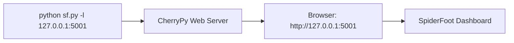
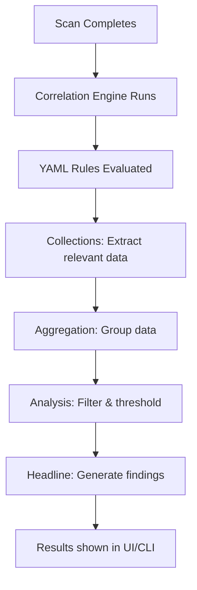

# 🕷️ SpiderFoot 4.0 — User Manual

> **SpiderFoot** is an open-source intelligence (OSINT) automation tool that integrates with 200+ data sources and performs automated analysis via a correlation engine. It can be used through a **web-based UI** or entirely via the **command line**.

---

## Table of Contents

1. [Installation & Setup](#1-installation--setup)
2. [Starting SpiderFoot](#2-starting-spiderfoot)
3. [Web UI Guide](#3-web-ui-guide)
4. [Command-Line Interface (CLI)](#4-command-line-interface-cli)
5. [Interactive CLI (sfcli.py)](#5-interactive-cli-sfclipy)
6. [Scan Targets](#6-scan-targets)
7. [Modules Overview](#7-modules-overview)
8. [Correlation Engine](#8-correlation-engine)
9. [Configuration & API Keys](#9-configuration--api-keys)
10. [Proxy & TOR Integration](#10-proxy--tor-integration)
11. [Output & Export](#11-output--export)
12. [Security & Authentication](#12-security--authentication)
13. [Docker Deployment](#13-docker-deployment)
14. [Troubleshooting](#14-troubleshooting)
15. [Quick Reference Card](#15-quick-reference-card)

---

## 1. Installation & Setup

### Prerequisites

| Requirement | Minimum Version |
|---|---|
| Python | 3.7+ |
| pip | Any recent |
| OS | Windows, Linux, macOS |

### Install Steps (Windows)

```powershell
# 1. Clone or download SpiderFoot to your preferred location
cd C:\Users\LENOVO\Documents\Spiderfoot\spiderfoot

# 2. Install Python dependencies
pip install -r requirements.txt

# 3. Create the data directory (if not created automatically)
mkdir "$env:USERPROFILE\.spiderfoot"
mkdir "$env:USERPROFILE\.spiderfoot\logs"

# 4. Verify installation
python sf.py --version
# Expected output: SpiderFoot 4.0.0: Open Source Intelligence Automation.
```

> [!NOTE]
> SpiderFoot stores its database, logs, and cache in `~/.spiderfoot/` by default. You can override this with environment variables `SPIDERFOOT_DATA`, `SPIDERFOOT_LOGS`, and `SPIDERFOOT_CACHE`.

### Install Steps (Linux/macOS)

```bash
cd ~/spiderfoot
pip3 install -r requirements.txt
python3 sf.py --version
```

---

## 2. Starting SpiderFoot

### Launch the Web UI

```powershell
# Start the web server on default port 5001
python sf.py -l 127.0.0.1:5001
```

Then open your browser and navigate to: **http://127.0.0.1:5001**



> [!TIP]
> To make SpiderFoot accessible on your local network, bind to `0.0.0.0` instead of `127.0.0.1`:
> `python sf.py -l 0.0.0.0:5001`
> **Only do this on trusted networks** and configure authentication first.

### Run a Scan Directly from Command Line

```powershell
# Scan a domain with all modules
python sf.py -s example.com

# Scan with specific modules
python sf.py -s example.com -m sfp_dnsresolve,sfp_portscan_tcp

# Scan with specific event types (auto-selects modules)
python sf.py -s example.com -t INTERNET_NAME,IP_ADDRESS

# Scan by use case
python sf.py -s example.com -u passive
```

---

## 3. Web UI Guide

The web UI is the easiest way to use SpiderFoot. It provides a full-featured dashboard for creating, managing, and analyzing scans.

### Dashboard Pages

| Page | Description |
|---|---|
| **New Scan** | Configure and launch a new scan with target, modules, and settings |
| **Scans** | View all previous and running scans |
| **Scan Results** | Browse, search, and filter results from a completed scan |
| **Settings** | Configure global settings, API keys, and module options |
| **Correlations** | View automated analysis findings from correlation rules |
| **Visualizations** | Graph-based data exploration (node graphs, charts) |

### Creating a Scan via Web UI

1. Click **"New Scan"** from the navigation bar
2. Enter a **scan name** (descriptive label)
3. Enter the **target** (domain, IP, email, etc.)
4. Choose scan approach:
   - **By Use Case**: Select "Footprint", "Investigate", "Passive", or "All"
   - **By Required Data**: Pick the event types you want collected
   - **By Module**: Hand-pick individual modules
5. Click **"Run Scan"**

### Viewing Results

- **Browse** tab: Tree-structured data view grouped by data type
- **Status** tab: Module-by-module progress and statistics
- **Visualizations** tab: Interactive graph showing entity relationships
- **Correlations** tab: Automated analysis findings (risk-rated)
- **Logs** tab: Detailed scan execution logs

### Export Options

From any scan result page you can export to:
- **CSV** — spreadsheet-compatible
- **JSON** — machine-readable
- **GEXF** — for graph analysis tools (Gephi, etc.)

---

## 4. Command-Line Interface (CLI)

### sf.py — Full CLI Reference

```
python sf.py [OPTIONS]
```

| Flag | Description |
|---|---|
| `-l IP:port` | Start the web server on the given IP and port |
| `-s TARGET` | Target for the scan (domain, IP, email, etc.) |
| `-m mod1,mod2,...` | Comma-separated modules to enable |
| `-M` / `--modules` | List all available modules and exit |
| `-t type1,type2,...` | Event types to collect (modules auto-selected) |
| `-T` / `--types` | List all available event types and exit |
| `-u USECASE` | Auto-select modules by use case: `all`, `footprint`, `investigate`, `passive` |
| `-o FORMAT` | Output format: `tab` (default), `csv`, `json` |
| `-f` | Filter: show only event types requested with `-t` |
| `-F type1,type2,...` | Show only these event types in output |
| `-H` | Suppress header row in tab/csv output |
| `-n` | Strip newlines from data fields |
| `-r` | Include source data field in tab/csv output |
| `-S LENGTH` | Max data length to display per field |
| `-D DELIMITER` | CSV delimiter (default: `,`) |
| `-x` | **Strict mode** — only modules that directly consume the target; only requested events |
| `-d` / `--debug` | Enable debug output |
| `-q` | Quiet mode — disable all logging (including errors) |
| `-C SCANID` / `--correlate` | Run correlation rules against an existing scan ID |
| `-V` / `--version` | Display version and exit |
| `-max-threads N` | Max number of modules to run concurrently (default: 3) |

### Usage Examples

```powershell
# List all available modules
python sf.py -M

# List all available event types
python sf.py -T

# Basic domain scan (all modules)
python sf.py -s example.com

# Passive-only scan of a domain
python sf.py -s example.com -u passive

# Scan for specific data types with JSON output
python sf.py -s example.com -t INTERNET_NAME,IP_ADDRESS -o json

# Strict mode scan: only direct modules, only requested events
python sf.py -s example.com -t INTERNET_NAME -x

# Run scan with specific modules and CSV output
python sf.py -s 192.168.1.1 -m sfp_dnsresolve,sfp_portscan_tcp -o csv

# Run correlation rules against a previous scan
python sf.py -C <scanID>

# Scan with more concurrency
python sf.py -s example.com -u footprint -max-threads 10
```

---

## 5. Interactive CLI (sfcli.py)

SpiderFoot includes a powerful interactive command-line shell that talks to the web server via its REST API.

### Starting the Interactive CLI

```powershell
# First, start the web server (in a separate terminal)
python sf.py -l 127.0.0.1:5001

# Then launch the CLI
python sfcli.py -s http://127.0.0.1:5001
```

### sfcli.py Launch Options

| Flag | Description |
|---|---|
| `-s URL` | SpiderFoot server base URL (default: `http://127.0.0.1:5001`) |
| `-u USERNAME` | Username for authentication |
| `-p PASSWORD` | Password for authentication |
| `-e "COMMAND"` | Execute a single command and exit |
| `-l FILE` | Log command output to a file |
| `-q` | Quiet mode — suppress banner and logging |

### Interactive CLI Commands

Once inside the `sf>` prompt, you have access to these commands:

| Command | Description |
|---|---|
| `start` | Start a new scan |
| `stop SCANID` | Stop a running scan |
| `delete SCANID` | Delete a scan and all its data |
| `scanlist` | List all scans |
| `scaninfo SCANID` | Show details of a scan |
| `data SCANID [TYPE]` | Show scan results, optionally filtered by type |
| `export SCANID` | Export scan data |
| `logs SCANID` | Show scan logs |
| `status SCANID` | Show scan status |
| `search QUERY` | Search scan data |
| `modules` | List available modules |
| `types` | List available event types |
| `set OPTION VALUE` | Set a CLI option |
| `correlate SCANID` | Run correlation rules against a scan |
| `ping` | Check if the server is reachable |
| `shell COMMAND` | Run a shell command |
| `history` | Show command history |
| `spool FILE` | Start/stop logging to a file |
| `clear` | Clear the screen |
| `help [COMMAND]` | Show help for a command |
| `exit` / `quit` | Exit the CLI |

### CLI Configuration Options

| Setting | Default | Description |
|---|---|---|
| `cli.debug` | `false` | Enable debug output |
| `cli.silent` | `false` | Suppress informational messages |
| `cli.color` | `true` | Enable colored output |
| `cli.output` | `pretty` | Output format (`pretty`, `json`, `csv`) |
| `cli.history` | `true` | Enable command history |
| `cli.history_file` | `""` | History file path |
| `cli.spool` | `false` | Enable logging to file |
| `cli.spool_file` | `""` | Spool file path |
| `cli.ssl_verify` | `true` | Verify SSL certificates |
| `cli.server_baseurl` | `http://127.0.0.1:5001` | Server URL |

### Example Session

```
sf> modules
[*] Modules available:
sfp_accounts               Look for possible associated accounts on over 500 social websites
sfp_dnsresolve             Resolves hostnames identified to IP addresses
...

sf> start -s example.com -m sfp_dnsresolve -n "My Test Scan"
[*] Scan started: ABC12345

sf> scanlist
[*] Scans:
ID          Name            Status    Target
ABC12345    My Test Scan    RUNNING   example.com

sf> data ABC12345 INTERNET_NAME
[*] Results:
www.example.com
mail.example.com
...

sf> stop ABC12345
[*] Scan ABC12345 stopped.
```

---

## 6. Scan Targets

SpiderFoot can scan the following target types — it automatically detects what you provide:

| Target Type | Example | What Gets Scanned |
|---|---|---|
| **Domain** | `example.com` | Subdomains, DNS, web content, WHOIS, certificates, etc. |
| **IP Address** | `192.168.1.1` | Reverse DNS, geolocation, reputation, open ports, etc. |
| **Hostname** | `www.example.com` | DNS resolution, web content, certificates |
| **Subnet (CIDR)** | `192.168.1.0/24` | All IPs in range — ports, reputation, geolocation |
| **ASN** | `AS1234` | Network blocks, associated IPs and domains |
| **Email Address** | `user@example.com` | Breach checks, social media, domain info |
| **Phone Number** | `+1234567890` | Carrier info, social media lookups |
| **Username** | `"johndoe"` | Account enumeration across 500+ social sites |
| **Person's Name** | `"John Doe"` | Social media, public records, data breaches |
| **Bitcoin Address** | `1A1zP1eP5Q...` | Blockchain analysis, transaction history |

> [!IMPORTANT]
> Usernames and person names **must be quoted** on the command line because they contain spaces or lack dots. SpiderFoot auto-detects the target type from the format.

---

## 7. Modules Overview

SpiderFoot has **200+ modules** organized into categories. Modules operate on a **publisher/subscriber** model — each module produces events that other modules consume, forming an automated data pipeline.

### Module Categories

| Category | Description | Examples |
|---|---|---|
| **Internal** | Built-in functionality, no external API needed | Web spider, DNS resolver, port scanner |
| **Free API** | Free third-party APIs (no key required) | Shodan (limited), VirusTotal (limited), HaveIBeenPwned |
| **Tiered API** | Free tier + paid tiers available | SecurityTrails, BinaryEdge, Censys |
| **Commercial API** | Requires paid API key | FullContact, Whoisology, RiskIQ |
| **Tool** | Wraps external CLI tools | Nmap, DNSTwist, WhatWeb, CMSeeK, TruffleHog |

### Use Case Groups

Modules are tagged by use case for easy selection:

| Use Case | Flag | Purpose |
|---|---|---|
| **Footprint** | `-u footprint` | Map the attack surface of a target |
| **Investigate** | `-u investigate` | Deep-dive into a specific entity |
| **Passive** | `-u passive` | Only passive techniques (no direct contact with target) |
| **All** | `-u all` | Enable everything |

### Key Modules

| Module | Description |
|---|---|
| `sfp_dnsresolve` | Core DNS resolution for hostnames → IPs |
| `sfp_dnsbrute` | Brute-force subdomain enumeration |
| `sfp_accounts` | Check 500+ social/web sites for accounts matching a username |
| `sfp_portscan_tcp` | TCP port scanning and banner grabbing |
| `sfp_spider` | Web spidering to extract content, links, emails |
| `sfp_shodan` | Query Shodan for device/service information |
| `sfp_haveibeenpwned` | Check email addresses against breach databases |
| `sfp_virustotal` | Check IPs/domains against VirusTotal |
| `sfp_whois` | WHOIS lookups on domains and IPs |
| `sfp_emailcrawlr` | Search for email addresses related to a domain |
| `sfp_certspotter` | Monitor SSL/TLS certificates for subdomains |
| `sfp_securitytrails` | DNS history, subdomains, associated domains |
| `sfp_dnszonexfer` | Attempt DNS zone transfers |
| `sfp_s3bucket` | Enumerate and check S3/Azure/DigitalOcean buckets |
| `sfp_tor` | Search Tor exit nodes and dark web search engines |
| `sfp_socialprofiles` | Find social media profiles for usernames |
| `sfp_grep_app` | Search code repositories for mentions |

---

## 8. Correlation Engine

SpiderFoot 4.0 includes a **YAML-based correlation engine** that automatically analyzes scan results and highlights interesting findings. It ships with **37 pre-built rules**.

### How It Works



### Built-in Correlation Rules

| Rule | Risk | What It Finds |
|---|---|---|
| `multiple_malicious` | HIGH | Hosts/IPs flagged malicious by multiple sources |
| `vulnerability_critical` | HIGH | Critical vulnerabilities found |
| `vulnerability_high` | HIGH | High-severity vulnerabilities |
| `database_exposed` | HIGH | Databases exposed on the Internet |
| `dns_zone_transfer_possible` | HIGH | DNS zone transfer vulnerability |
| `remote_desktop_exposed` | MEDIUM | RDP/VNC exposed to the Internet |
| `cert_expired` | MEDIUM | Expired SSL certificates |
| `email_in_multiple_breaches` | MEDIUM | Email found in multiple data breaches |
| `open_port_version` | INFO | Open port revealing software version |
| `outlier_webserver` | INFO | Unusual web server (possible shadow IT) |
| `outlier_country` | INFO | Hosting in unexpected country |
| `dev_or_test_system` | INFO | Development/test systems exposed |
| `stale_host` | INFO | Hostnames pointing to stale/dead IPs |

### Running Correlations Manually

```powershell
# Run correlation rules against an existing scan
python sf.py -C <scanID>
```

### Writing Custom Rules

Create a YAML file in the `correlations/` folder. Copy `template.yaml` as a starting point:

```yaml
id: my_custom_rule
version: 1
meta:
  name: My Custom Correlation
  description: >
    Description of what this rule detects.
  risk: MEDIUM
collections:
  - collect:
      - method: exact
        field: type
        value: INTERNET_NAME
      - method: regex
        field: data
        value: .*test.*
aggregation:
  field: data
headline: "Test system found: {data}"
```

> [!TIP]
> Correlation rules analyze scan data — they don't collect data themselves. Make sure your scan includes modules that produce the event types your rule needs.

---

## 9. Configuration & API Keys

### Global Settings

Key global configuration options (set via Web UI → Settings, or in the scan config):

| Setting | Default | Description |
|---|---|---|
| `_debug` | `false` | Enable debug logging |
| `_maxthreads` | `3` | Concurrent module execution limit |
| `_useragent` | Firefox UA string | HTTP User-Agent (prefix with `@` for file-based rotation) |
| `_dnsserver` | System default | Custom DNS resolver (e.g., `8.8.8.8`) |
| `_fetchtimeout` | `5` | HTTP request timeout in seconds |
| `_socks1type` | *(empty)* | Proxy type: `4`, `5`, `HTTP`, or `TOR` |
| `_socks2addr` | *(empty)* | Proxy IP address |
| `_socks3port` | *(empty)* | Proxy port |

### Adding API Keys

Many modules work better (or only) with API keys. Configure them in the **Web UI → Settings** page under each module, or set them before running a CLI scan.

Popular API keys to configure:

| Service | Module | Free Tier? |
|---|---|---|
| Shodan | `sfp_shodan` | ✅ Limited |
| VirusTotal | `sfp_virustotal` | ✅ Limited |
| SecurityTrails | `sfp_securitytrails` | ✅ Limited |
| HaveIBeenPwned | `sfp_haveibeenpwned` | ❌ Paid |
| Censys | `sfp_censys` | ✅ Limited |
| BinaryEdge | `sfp_binaryedge` | ✅ Limited |
| FullContact | `sfp_fullcontact` | ❌ Paid |
| AlienVault OTX | `sfp_alienvault` | ✅ Free |

> [!NOTE]
> API keys are stored in the SQLite database at `~/.spiderfoot/spiderfoot.db`. You can **export/import** API keys between instances through the Web UI settings page.

---

## 10. Proxy & TOR Integration

### SOCKS Proxy

Configure in the Web UI settings or via the global config:

```
Proxy Type: 5 (SOCKS5)
Proxy Address: 127.0.0.1
Proxy Port: 1080
```

### TOR Integration

SpiderFoot can route all traffic through TOR for anonymity and dark web searching:

1. Install and start TOR on your system
2. Set proxy type to `TOR`
3. Set proxy address to `127.0.0.1`  
4. Set proxy port to `9050` (default TOR SOCKS port)

```
Proxy Type: TOR
Proxy Address: 127.0.0.1
Proxy Port: 9050
```

> [!WARNING]
> Not all modules work well through TOR. Some APIs may block TOR exit nodes. DNS resolution may also behave differently.

---

## 11. Output & Export

### Command-Line Output Formats

| Format | Flag | Description |
|---|---|---|
| Tab-separated | `-o tab` | Default; human-readable columns |
| CSV | `-o csv` | Comma-separated; importable to Excel |
| JSON | `-o json` | Machine-readable; for scripting |

### Web UI Export

From any scan result page, click the export button to download:
- **CSV** — all scan data in spreadsheet format
- **JSON** — full structured data dump
- **GEXF** — graph format for tools like Gephi

### SQLite Database

All data is stored in `~/.spiderfoot/spiderfoot.db`. You can query it directly:

```sql
-- List all scans
SELECT * FROM tbl_scan_config;

-- Get results for a scan
SELECT * FROM tbl_scan_results WHERE scan_instance_id = '<scanID>';

-- View correlation results
SELECT * FROM tbl_scan_correlation_results;
```

---

## 12. Security & Authentication

> [!CAUTION]
> By default, SpiderFoot has **no authentication**. Anyone who can reach the web server can run scans. Always configure authentication if exposed beyond localhost.

### Setting Up Authentication

Create a password file to enable digest authentication:

```powershell
# The passwd file format is: username:SpiderFoot:password_hash
# Generate with Python:
python -c "import hashlib; print('admin:SpiderFoot:' + hashlib.md5(b'admin:SpiderFoot:yourpassword').hexdigest())"
```

Save the output to `~/.spiderfoot/passwd` and restart SpiderFoot.

### HTTPS / SSL

For HTTPS, generate certificates and configure CherryPy. SpiderFoot includes a helper script:

```bash
./generate-certificate
```

---

## 13. Docker Deployment

### Quick Start with Docker

```bash
# Basic run
docker build -t spiderfoot .
docker run -p 5001:5001 spiderfoot

# With docker-compose
docker-compose up -d
```

### docker-compose.yml

The included `docker-compose.yml` maps port 5001 and provides volume persistence for the database.

### Full Image (with external tools)

```bash
# Build the full image with Nmap, DNSTwist, WhatWeb, etc.
docker build -f Dockerfile.full -t spiderfoot-full .
docker run -p 5001:5001 spiderfoot-full
```

---

## 14. Troubleshooting

### Common Issues

| Problem | Solution |
|---|---|
| `PermissionError: Access is denied: ~/.spiderfoot/` | Manually create the directory: `mkdir ~/.spiderfoot` and `mkdir ~/.spiderfoot/logs` |
| `ModuleNotFoundError` | Run `pip install -r requirements.txt` again |
| Web UI not loading | Check the terminal for errors; ensure port 5001 isn't in use |
| Scan produces no results | Check if target is correct; try with fewer modules first |
| API module returns errors | Verify API key is configured in Settings |
| `lxml` / `cryptography` build errors | Install Visual C++ Build Tools (Windows) or `build-essential` (Linux) |

### Environment Variables

| Variable | Purpose |
|---|---|
| `SPIDERFOOT_DATA` | Override default data directory |
| `SPIDERFOOT_LOGS` | Override default logs directory |
| `SPIDERFOOT_CACHE` | Override default cache directory |

### Logs

Logs are stored in `~/.spiderfoot/logs/`. Check them for detailed error information.

---

## 15. Quick Reference Card

### Start Web UI
```powershell
cd C:\Users\LENOVO\Documents\Spiderfoot\spiderfoot
python sf.py -l 127.0.0.1:5001
# Open http://127.0.0.1:5001
```

### Quick Scan (CLI)
```powershell
# Domain recon
python sf.py -s example.com -u footprint

# Passive only
python sf.py -s example.com -u passive

# Specific modules
python sf.py -s example.com -m sfp_dnsresolve,sfp_whois,sfp_certspotter

# Specific data types, JSON output
python sf.py -s example.com -t INTERNET_NAME,IP_ADDRESS -o json
```

### Interactive CLI
```powershell
# Terminal 1: Start server
python sf.py -l 127.0.0.1:5001

# Terminal 2: Connect CLI
python sfcli.py -s http://127.0.0.1:5001
```

### List Capabilities
```powershell
python sf.py -M    # List all modules
python sf.py -T    # List all event types
```

### Key File Locations
```
~/.spiderfoot/              # Data directory
~/.spiderfoot/spiderfoot.db # SQLite database
~/.spiderfoot/logs/         # Log files
~/.spiderfoot/cache/        # Cache files
correlations/               # Correlation rules (YAML)
modules/                    # Scanner modules (Python)
```

---

> [!TIP]
> **Getting the most from SpiderFoot:**
> 1. Start with a **passive** scan (`-u passive`) to avoid touching the target directly
> 2. Add **API keys** for services like Shodan, VirusTotal, and SecurityTrails for richer data
> 3. Review **correlation results** after each scan for automatically identified findings
> 4. Use the **Web UI** for exploration and the **CLI** for automation and scripting
> 5. Increase `-max-threads` for faster scans on powerful machines

---

*SpiderFoot 4.0.0 • MIT License • Created by Steve Micallef • [spiderfoot.net](https://www.spiderfoot.net)*
